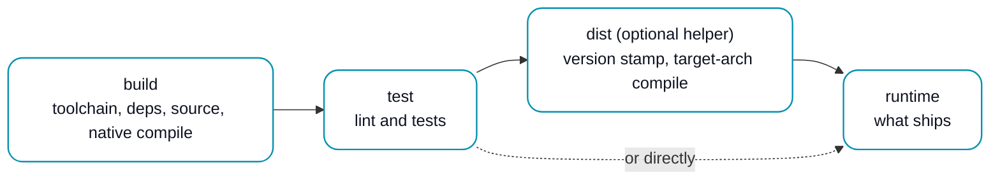

# Dockerfile stages

The stage names a component's Dockerfile uses, what each stage holds, and what `erun build` and `erun e2e` do with them. For the Operator view of where tests run in the delivery flow, see [Delivery pipeline · How you set it up](/pipeline#where-tests-run).

A component tests itself as part of its own build. Its Dockerfile runs the component's own lint and test commands, and ERun adds no test logic and no separate test phase: `erun build` is `docker build` of the Dockerfile's last stage. Every stage only calls commands the component already has (`go test ./...`, `yarn test`, `go tool golangci-lint run`, a `*_test.sh` script), so a developer gets the same result from a plain `docker build`.

## The stages

A component Dockerfile chains its stages so that the shipped artefacts pass through the tested stage:



| Stage | `FROM` | Contents | Who runs it |
|---|---|---|---|
| `build` | The toolchain image, pinned with `--platform=$BUILDPLATFORM`. | Toolchain installs, including tools only the tests need, so they sit below the source `COPY` and stay cached. Dependency download with cache mounts, then the source `COPY`, then a compile for the build platform that the tests can use. No version stamping, no `TARGET*` arguments, no lint or tests. | `docker build --target build` by hand; `erun build` reaches it through `test`. |
| `test` | `build`. A stage stands alone only when the component has nothing to compile, such as an image of scripts and charts. | Test-only `COPY`s, then the component's own lint and test commands. Nothing that needs a deployed environment. | `docker build --target test` by hand; `erun build` through the stages that use it. |
| Helpers (any other name, such as `dist`) | `test`. | Version stamping (`ERUN_VERSION`) and the compile for `TARGETARCH`. | Only through `runtime`. |
| Download-only stages (such as a target-arch tool fetch) | A base image; they read no other stage. | A tool or binary the runtime image needs for the target architecture. | Only through `runtime`. |
| `runtime` (the last stage) | A slim base or `scratch`. | Artefacts copied from `test` or from a helper built `FROM test`, plus configuration files from the build context. No build tools, except where the tools are the product. | Default `docker build`, and `erun build`. |
| `e2e` | A dependencies stage (`deps`) in a separate Dockerfile under `<tenant>-devops/e2e/<component>/`. | A suite that runs against a deployed environment. | [`erun e2e`](/cli/e2e) only; never `erun build`. See [The `e2e` stage](#e2e-stage). |

A minimal Go component:

```dockerfile
FROM --platform=$BUILDPLATFORM golang:1.26.0 AS build
WORKDIR /src
COPY app/go.mod app/go.sum ./
RUN --mount=type=cache,target=/go/pkg/mod go mod download
COPY app/ ./
RUN --mount=type=cache,target=/go/pkg/mod \
    --mount=type=cache,target=/root/.cache/go-build \
    go build ./...

FROM build AS test
RUN --mount=type=cache,target=/go/pkg/mod \
    --mount=type=cache,target=/root/.cache/go-build \
    go vet ./... && go test ./...

FROM test AS dist
ARG TARGETOS=linux
ARG TARGETARCH
RUN --mount=type=cache,target=/go/pkg/mod \
    --mount=type=cache,target=/root/.cache/go-build \
    CGO_ENABLED=0 GOOS=${TARGETOS} GOARCH=${TARGETARCH} \
    go build -trimpath -ldflags "-s -w" -o /out/app ./cmd/app

FROM alpine:3.20 AS runtime
COPY --from=dist --chmod=0755 /out/app /usr/local/bin/app
ENTRYPOINT ["app"]
```

A component with nothing to stamp or cross-compile, such as a static site, has no helper: its `runtime` copies the built output straight from `test` (`COPY --from=test /src/site/build /site`).

The `erun-blueprint-service` and `erun-blueprint-docs` [skills](/agent-reference/skills-spec) write Dockerfiles in this shape.

## Why `runtime` copies from `test` {#why-runtime-copies-from-test}

BuildKit builds only the stages the target stage depends on. If `runtime` copied its artefacts from `build`, nothing would depend on `test`, BuildKit would skip it, and the image would ship without its tests having run, with a zero exit code.

Copying the artefacts from `test`, or from a helper built `FROM test`, makes `test` part of every build of `runtime`. A failing test fails the build, and no image exists. This holds for a plain `docker build` as much as for `erun build`, so the component stays independent of ERun. There is no marker file to copy and nothing for ERun to inject.

Version stamping and the target-arch compile sit in a helper after `test` for the same reason the toolchain sits in `build`: a layer reruns when its inputs change. With `ERUN_VERSION` and `TARGETARCH` read only in `dist`, a version-only change reruns `dist` and finds `test` cached.

## What `erun build` does with the stages {#erun-build}

`erun build` runs one `docker build` of the last stage per platform, with no `--target`. On top of that it does four things.

### Refuses a `test` stage nothing uses {#unused-test-stage}

Before anything builds, `erun build` and `erun push` read each Dockerfile. A Dockerfile that declares a stage named exactly `test` must have a later stage that uses it, in one of these forms:

- `FROM test AS <name>` (with or without `--platform`);
- `COPY --from=test ...` or `ADD --from=test ...`, with any other flags;
- `RUN --mount=...,from=test ...`.

A Dockerfile that declares `test` without any of those is refused, because the build would silently skip its tests:

```
<path>/Dockerfile declares a stage named "test" that no later stage consumes, so docker build would skip it and its tests would never run: take the image's artifacts from the tested stage (`COPY --from=test <artifact> <dest>` in the final stage, or build a helper stage `FROM test` and copy from that), or rename the stage if it is not the component's tests
```

ERun does not trace the stage graph further. It does not check that the use reaches `runtime`, or that `runtime` takes nothing from `build`; those are the shape above, which the component owns. A Dockerfile with no `test` stage builds unchanged and reports `test: none declared`.

The stage name is exact: `AS test`. A stage named `test-unit` or `tests` is neither checked nor treated as the test stage.

### Grants host networking to the test stage {#host-network}

A Dockerfile that declares a `test` stage is built with `--allow network.host`, so a test that starts its own containers can reach a docker daemon from a `RUN --network=host` step. See [Tests that need a container runtime](#tests-that-need-a-container-runtime).

### Reports the test outcome per component {#test-outcome}

After a successful build, each component gets one line naming what the build established about its tests:

| Line | Meaning |
|---|---|
| `<component>: test: passed` | The `test` stage was part of a successful `docker build`. BuildKit may have served it from its layer cache on byte-identical inputs, which is equally valid. |
| `<component>: test: reused (fingerprint fp-<hash>)` | No `docker build` ran: the component's [fingerprint](/agent-reference/conventions-spec#fingerprint-cache) matched an earlier successful build, whose tests ran, and that image was promoted. |
| `<component>: test: none declared` | The Dockerfile has no `test` stage. |

A promotion that falls back to a rebuild reports `passed`. A failed build and a `--dry-run` print no outcome line.

### Refuses an e2e suite {#refuses-e2e}

A Dockerfile under `<tenant>-devops/e2e/` is a suite, not a component. Discovery never walks `e2e/`, and `erun build` or `erun push` run from inside a suite directory refuse it:

```
<path>/Dockerfile is an e2e suite, not a component: erun build and push never build <tenant>-devops/e2e/; run it against a deployed environment with `erun e2e --component <suite>`
```

## When tests rerun {#reuse}

A component's tests run only when something they depend on changed:

1. **Fingerprint promotion.** When the component's whole fingerprint matches an existing `fp-<hash>` tag for every requested platform, no `docker build` runs, and the build reports `test: reused`. The fingerprint covers the Dockerfile, every `COPY` source in every stage, the component chart, and `ERUN_VERSION` when the Dockerfile reads it. An `fp-` tag is written only after a successful build, and that build included `test`.
2. **BuildKit layer cache.** Otherwise `docker build` runs, and BuildKit reruns `test` only when the `build` stage's result, the `test` stage's own instructions, or its test-only `COPY` content changed. A change that only touches `dist` or `runtime`, such as a version bump, is a cache hit for `test`.

Layer-cache reuse is best-effort. It needs a warm cache. A fresh environment, a pruned build cache, or a moved base-image tag reruns the tests, which is the safe direction. A second architecture's build can also rerun them; ERun does not rely on that cache hit. Nothing is skipped without evidence that the same inputs passed before.

A fingerprint hashes the Dockerfile's text, not the image a `FROM` tag resolves to. A base-image tag that moves to new content therefore does not invalidate an `fp-` tag or a [package component's recorded pass](#package-components); change the tag (or pin a digest) to retest against the new base, or build with `--no-incremental`.

How long an unchanged component's layers stay cached depends on how much build cache the daemon keeps. BuildKit's garbage collection, set by `builder.gc` in the Docker daemon configuration (`defaultKeepStorage`, or `defaultReservedSpace`, `defaultMaxUsedSpace` and `defaultMinFreeSpace` on newer Docker Engine releases), evicts the least recently used layers once the cache passes its cap. Inside an environment pod with a sized docker volume, `erun build` also reclaims the cache down to the environment's share of that volume before it builds. A component that has not been built for a while, on a busy daemon with a small cap, reruns its tests on its next build.

## Tests that need a container runtime {#tests-that-need-a-container-runtime}

A test that starts its own container fixture, such as a Testcontainers-style ephemeral database, needs a docker daemon but no deployment. It belongs in `test`.

```dockerfile
FROM build AS test
ARG DOCKER_HOST=tcp://127.0.0.1:2375
RUN --network=host \
    DOCKER_HOST=${DOCKER_HOST} \
    go test ./... -run TestAgainstRealPostgres
```

Plain `docker build` refuses `RUN --network=host` with BuildKit's `network.host is not allowed`; add `--allow network.host` when building by hand. `erun build` adds it for any Dockerfile that declares a `test` stage, and never for one that does not.

The daemon at `127.0.0.1:2375` is the one building the image. In an agent env's pod, its docker sidecar answers there. Anywhere else, such as a host environment or a laptop, `erun build` starts a loopback-only forwarder from that address to its own daemon for the length of the build.

A plain `docker build` starts no forwarder. A `RUN` step cannot reach the daemon's unix socket, so pass a daemon it can reach over TCP:

```bash
docker build --target test --allow network.host \
  --build-arg DOCKER_HOST=tcp://<host>:<port> \
  -f acme-devops/docker/acme-api/Dockerfile .
```

Inside an agent env's pod, the default `tcp://127.0.0.1:2375` already answers, so no `--build-arg` is needed.

The grant is a deliberate capability, not a sandbox: a `RUN --network=host` step can reach the daemon that is building it and start, stop or inspect its containers. A component's test stage is trusted code running against its own environment's runtime.

Two kinds of test never belong in `test`:

- a test that drives the component's own shipped image or a deployment of it;
- a test that asserts a deployed version.

Both run after [`deploy`](/cli/deploy), as an [`e2e` suite](#e2e-stage).

## Package components {#package-components}

A Dockerfile under `<tenant>-devops/linux/<name>/` builds a Debian package, never an image. It uses the same chain, ending in `dist` instead of `runtime`:

| Stage | `FROM` | Contents |
|---|---|---|
| `build` | The toolchain image, pinned with `--platform=$BUILDPLATFORM`. | As for an image component: toolchain, dependencies, source, a native compile. |
| `test` | `build`. | The component's own lint and tests. A package whose code is tested in another component's build has no `test` stage. |
| A packing helper (such as `package`) | `test`, or `build` when there is no `test`. | Version stamping, the compile for `TARGETARCH`, and `dpkg-deb --build`. |
| `dist` (the last stage) | `scratch`. | The `.deb` alone, copied from the helper, so a local output export writes the package and nothing else. |

By hand:

```bash
docker build -f acme-devops/linux/acme-cli/Dockerfile --target dist \
  --platform linux/amd64 --build-arg ERUN_VERSION=1.2.3 \
  --output type=local,dest=out .
```

leaves `out/<package>_1.2.3_amd64.deb`. A plain `erun build` runs a package component through its `test` stage with `--output type=cacheonly`, so its tests gate every build and nothing is published. A package without a `test` stage runs its `build` stage instead and reports `<package>: test: none declared`.

A package keeps no image to promote, so a passing run is recorded on the machine that ran it, under `~/.erun/package-tests/`. The record is keyed by:

- a fingerprint of the Dockerfile's text and the `COPY` sources of the stages that run;
- the platform the Docker daemon builds for, which `erun build` asks the daemon with `docker version` once per build. This is not the host's own architecture when `DOCKER_HOST` names a remote daemon. A daemon that does not answer means nothing is reused or recorded.

The next plain build with the same fingerprint on the same platform runs nothing and reports `<package>: test: reused (fingerprint fp-<hash>)`. A package without a `test` stage still reports `test: none declared`, because no tests ran in either build.

A recorded pass expires after 30 days, and each package keeps its 8 most recent passes. The fingerprint does not cover the image a `FROM` tag resolves to, so a base-image tag that moves to new content reuses the old pass until it expires. Build with `--no-incremental` to retest against the new base sooner. `--no-incremental` neither reuses nor records a pass, and `erun build --release` never reuses one; `erun build --release` builds `dist` for both architectures and uploads the packages to the release (see [Release flow · Linux packages](/deployment/release-flow#linux-packages)).

## The `e2e` stage {#e2e-stage}

A suite that checks a deployed environment lives in its own Dockerfile, next to the component's `docker/` and `k8s/` directories:

```
<tenant>-devops/
  docker/<component>/Dockerfile   # build, test, runtime
  k8s/<component>/Chart.yaml
  e2e/<component>/Dockerfile      # deps, e2e
  e2e/<component>/...             # the suite
```

The build context is the project root, as for component Dockerfiles. The suite directory's name is the exposed service the suite targets by default. The Dockerfile declares two stages:

```dockerfile
FROM mcr.microsoft.com/playwright:v1.62.1-noble AS deps
WORKDIR /e2e
COPY acme-devops/e2e/acme-web/package.json acme-devops/e2e/acme-web/yarn.lock ./
RUN yarn install --frozen-lockfile --non-interactive

FROM deps AS e2e
COPY acme-devops/e2e/acme-web/ ./
ARG ERUN_E2E_BASE_URL
ARG ERUN_E2E_VERSION
RUN npx playwright test
```

Pin the browser image to the version the lockfile resolves, so the browsers baked into it are the ones the test runner expects.

### How `erun e2e` runs it {#e2e-invocation}

[`erun e2e`](/cli/e2e) builds each suite's `e2e` stage, in name order:

```
docker build --progress=plain --target e2e --no-cache-filter e2e --output type=cacheonly \
  --build-arg ERUN_E2E_VERSION=<deployed version> \
  --build-arg ERUN_E2E_BASE_URL=<https URL of the service named like the suite> \
  --build-arg ERUN_E2E_URL_<SERVICE>=<https URL> ... \
  [--secret id=<id>,env=<VAR> ...] \
  -f <tenant>-devops/e2e/<component>/Dockerfile .
```

- `--no-cache-filter e2e` reruns the `e2e` stage every time, while `deps` and anything before it stay cached. A Dockerfile cannot express this itself: BuildKit has no per-stage "never cache" instruction.
- `--output type=cacheonly` keeps no image. A suite is never fingerprinted, promoted, tagged or pushed.
- The suite gets no host networking. It reaches the environment the way a user does, through its HTTPS ingress, with the certificate verified.

### Targeting {#e2e-targeting}

By default the suite runs against the live environment, and ERun supplies every value the suite needs as a build argument:

| Build argument | Value |
|---|---|
| `ERUN_E2E_VERSION` | The version the environment is deployed at, read from its live release, or the value of `--version` when one is passed. |
| `ERUN_E2E_BASE_URL` | The HTTPS URL of the exposed service whose name matches the suite's directory. |
| `ERUN_E2E_URL_<SERVICE>` | The HTTPS URL of every exposed service, with the name upper-cased and every character other than a letter or digit turned into `_` (`acme-api` becomes `ERUN_E2E_URL_ACME_API`). |

A suite's first assertion is normally that the served surface reports `ERUN_E2E_VERSION`, which tells a fresh rollout apart from a stale one.

Before any suite runs, `erun e2e` checks that the environment is deployed, that each suite's service is exposed, and that its certificate is issued.

To override the target, pass `--base-url <url>`. Every suite in that run uses it as `ERUN_E2E_BASE_URL` and the exposure and certificate checks are skipped. `--base-url` also needs to know the version that URL serves: pass `--version <v>`, and nothing is read from any environment, or name the environment it serves with `--tenant`/`--environment`, and that environment's deployed version is resolved. `--base-url` with neither is refused. `--version` alone keeps the deployment and exposure checks and replaces only the deployed version. By hand, it is the same `docker build` with your own `--build-arg` values.

Credentials a suite needs come from the `.erun/config.yaml` [`e2e.secrets`](/reference/configuration#e2e-secrets) list and arrive as BuildKit secrets, mounted with `RUN --mount=type=secret,id=<id>`. That list is separate from `docker.secrets` on purpose: `docker.secrets` reach every component build, so an e2e credential declared there would become mandatory for every build.

### Refusals {#e2e-refusals}

`erun e2e` refuses, before any suite runs and naming the cause, when:

- a suite's Dockerfile declares no stage named exactly `e2e`;
- the project still has a `<tenant>-devops/playwright` folder, or sets `paths.playwright` or `components.<name>.playwright` (the error names the move to `e2e/<component>/Dockerfile`);
- `components.<name>.e2e` is set (suites are discovered project-wide; use `paths.e2e`);
- the environment is not deployed, or its deployed version cannot be resolved;
- a suite's service is not exposed, or its certificate is not issued yet;
- a resolved URL points at a loopback address, as a local cluster's ingress on `127.0.0.1` does: the suite runs in a docker build without host networking, where loopback is the build container itself (pass `--base-url` with an address a docker build can reach, together with `--version` or `--tenant`/`--environment`);
- a suite's `playwright.config.ts` or `playwright.config.js` sets `ignoreHTTPSErrors` or hardcodes `baseURL`;
- a declared `e2e.secrets` entry cannot be supplied.

### Place in the flow {#e2e-place}

`erun e2e` is a separate command with its own exit code. `erun build`, `erun deploy` and releases never run it, and it is not a release or merge gate. A failing suite exits non-zero and changes nothing: no rollback, no block, no issue filed. Its output names the suite, component, target URL, deployed version, failing step, log path and the log's last lines, so the caller, an Agent or a scheduled run, can file the bug.

## Where next

- [`erun e2e`](/cli/e2e) — the command, its flags and its error behaviour.
- [Conventions spec · Docker build context resolution](/agent-reference/conventions-spec#docker-build-context-resolution) — which directory a Dockerfile builds from.
- [Delivery pipeline](/pipeline) — where build, deploy and e2e sit in the flow.
